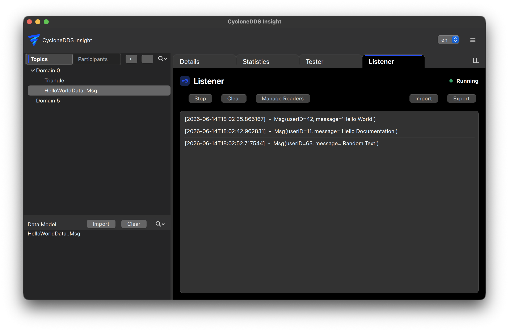

..
   Copyright(c) 2024 Sven Trittler

   This program and the accompanying materials are made available under the
   terms of the Eclipse Public License v. 2.0 which is available at
   http://www.eclipse.org/legal/epl-2.0, or the Eclipse Distribution License
   v. 1.0 which is available at
   http://www.eclipse.org/org/documents/edl-v10.php.

   SPDX-License-Identifier: EPL-2.0 OR BSD-3-Clause

Listener
========

The listener feature in |var-project| allows you to monitor and log specific events occurring within the DDS system.

General
-------

1. In the main view select the "Listener" tab
2. From the data model list on the left select the desired topic and create a reader
3. Monitor incoming data and events in real-time

Sample views
------------

Use the view selector next to "Clear" to switch between "Message log" (every
received sample) and "Latest per instance" (one row per DDS instance per reader).
In the instance view, samples with the same DDS key update the existing row,
including its timestamp and sample information. Topics without keys have one
instance per reader. Instance state notifications also update that row.

You can switch views at any time. The full message log continues to be retained
and is used for sample export; the instance view reduces displayed rows, not log
memory usage. "Clear" clears both views.

Searching messages
------------------

Enter text in the search field next to the view selector and press Enter to
filter message contents. Matching is case-insensitive and works in both views,
together with the reader selection. Incoming samples and instance updates are
checked against the applied search. Empty the field and press Enter to remove
the filter. Searching does not change the stored log or sample export.

Presets
-------

To quickly set up listeners for common scenarios, presets can be used to create multiple readers with predefined configurations.
The listener-preset import/export entries form a separate section in Actions,
separated from log and replay operations by a divider. Listener presets contain
reader configuration without message data; log and replay exports contain the
received messages.

Recording and replay
--------------------

All valid samples received by the listener are automatically available for replay
export. Use Actions → Export replay to save the listener history as JSON. There
is no separate recording mode. Clearing the listener also clears the history
available for replay. Changing views, searching, or hiding readers does not
change the stored history. DDS instance-state notifications without valid data
remain in the log but cannot be replayed as publishable messages.

The JSON uses the tester preset format, including domain, topic, type, QoS and
the existing data-tree message serialization. Additional ``replay`` metadata
stores the chronological message references and receive-time offsets across
readers. A recording can also be imported directly into the Tester, including a
sequence preset preserving its message order. As with
tester presets, the required datatypes must be available; import their IDL first
when using a recording in another installation. Union fields are not currently
supported by the preset data tree; replay export reports an error for these types.

Use Actions → Import replay to open a recording as a tab immediately to the
right of Listener in the main tab bar. Its title is the replay filename; hover
over the tab to reveal its close button. Ordinary
tester preset JSON files can also be opened there. Importing never publishes
messages automatically. Select individual messages directly in the list using their checkboxes or by
clicking their rows, then press Play to publish only those messages in their
original order with the stored topic and QoS settings. All messages are selected
initially; use Select all or Deselect all to change the whole selection. The
default interval is 100 ms; select "Use original timing" to retain the recorded
time gaps between the selected messages, including the elapsed time of skipped
messages. Original timing for ordinary presets without replay metadata falls
back to 100 ms. Stop or close the replay tab to end playback and release its
writers. Multiple replay files can be open in separate tabs.

Tree view and watchlist
-----------------------

The listener displays messages as text by default. Enable Actions → Tree view to inspect
structured fields and expand nested objects, sequences and arrays. Right-click a
field name or value to add it to the watchlist. A watched field stays visible
when its ancestors are collapsed, with its full field path. Watching a parent
object also highlights and retains each nested field individually, including
fields added by later samples. Individual children can be removed from a parent
watch without removing the other fields. Watches apply to
other messages from the same reader, topic and datatype, including subsequent
instance updates. Use Actions → Clear watchlist to remove all watches.
