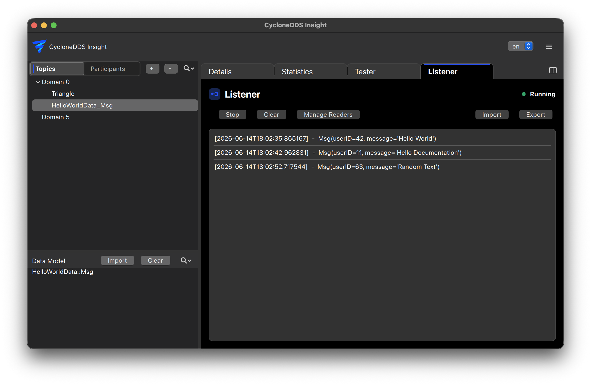

..
   Copyright(c) 2024 Sven Trittler

   This program and the accompanying materials are made available under the
   terms of the Eclipse Public License v. 2.0 which is available at
   http://www.eclipse.org/legal/epl-2.0, or the Eclipse Distribution License
   v. 1.0 which is available at
   http://www.eclipse.org/org/documents/edl-v10.php.

   SPDX-License-Identifier: EPL-2.0 OR BSD-3-Clause

Listener
========

The listener feature in |var-project| allows you to monitor and log specific events occurring within the DDS system.

General
-------

1. In the main view select the "Listener" tab
2. From the data model list on the left select the desired topic and create a reader
3. Monitor incoming data and events in real-time

Sample views
------------

Use the view selector next to "Clear" to switch between "Message log" (every
received sample) and "Latest per instance" (one row per DDS instance per reader).
In the instance view, samples with the same DDS key update the existing row,
including its timestamp and sample information. Topics without keys have one
instance per reader. Instance state notifications also update that row.

You can switch views at any time. The full message log continues to be retained
and is used for sample export; the instance view reduces displayed rows, not log
memory usage. "Clear" clears both views.

Searching messages
------------------

Enter text in the search field next to the view selector and press Enter to
filter message contents. Matching is case-insensitive and works in both views,
together with the reader selection. Incoming samples and instance updates are
checked against the applied search. Empty the field and press Enter to remove
the filter. Searching does not change the stored log or sample export.

Presets
-------

To quickly set up listeners for common scenarios, presets can be used to create multiple readers with predefined configurations.
The listener-preset import/export entries form a separate section in Actions,
separated from log and replay operations by a divider. Listener presets contain
reader configuration without message data; log and replay exports contain the
received messages.

Recording and replay
--------------------

Received data samples and Dispose notifications are automatically available for
replay export. Use Actions → Export Record/Replay to save the listener history as JSON. There
is no separate recording mode. Clearing the listener also clears the history
available for replay. Changing views, searching, or hiding readers does not
change the stored history. Dispose events retain their keys and are replayed as
DDS Dispose operations, in order with writes. Other instance-state notifications,
such as no-writers notifications, remain in the log without becoming writes.

The JSON uses the tester preset format, including domain, topic, type, QoS and
message data. Each original DDS writer is exported as a separate preset within
its reader configuration, even when topic and type are identical. Presets sharing
a topic have numbered writer names. Write and Dispose operations from the same
DDS publication stay together, including when its GUID is temporarily unavailable.

The sequence preset stores chronological references, operations and the delay
before each step in ``sequence_steps``. Delays come from the listener's monotonic
receive times; the first step has a zero delay. Messages retain their source and
receive timestamps as provenance. There is no separate ``replay`` section.
For older Tester versions, ``sequence_items`` contains only Write steps.

Use Import Record/Replay in the main menu, or File → Import Record/Replay on
macOS. A successful import switches to Tester and selects the imported sequence;
it never sends messages automatically. The normal Tester import accepts these
files as well. There is no separate replay tab. Multiple recordings can be
imported and selected as separate sequences in Tester.

In the sequence editor, select the steps to play, choose sequence delays or a
fixed interval, then press Play. Use Edit sequence to change operations, delays
and order. The first selected step is sent immediately. With sequence delays,
skipping steps retains the elapsed time between the selected steps. A step's
send button executes only that step, ignoring its delay and the selection.

Playback prepares the existing Tester writers as needed, then executes Write
and Dispose calls in sequence order. Each call completes before the next is
sent, including across domains. Stop cancels the remaining steps; an in-flight
DDS operation finishes before editing or restarting is enabled. Writers remain
active until stopped or removed in Tester, or until the application exits.
Writer creation does not guarantee that every receiver has already matched.

Completion of a DDS call does not mean that a remote application has consumed
the sample. Listener readers are polled in turn, and DDS can group queued samples
by instance. With a backlog, the displayed order can differ from the sending
order. Recordings preserve the order in which samples were taken by the listener.

The required datatypes must be available when importing a recording; import their
IDL first on another installation. Union fields are not currently supported by
the preset data tree, and export reports an error for these fields.

Exports are enabled when their source data is available: listener presets need
at least one reader, sample logs need received messages, and Record/Replay needs
received data samples or Dispose events.

Record/Replay export shows a loading view immediately and processes a snapshot
of the recorded messages in the background. Messages received after export starts
are included in the next export. An export error leaves an existing destination
file intact.

Tree view and watchlist
-----------------------

The listener displays messages as a tree by default. Use the tree button to the
left of Actions to switch between structured fields and plain text. The adjacent
Clear button clears the received messages. Messages start
collapsed, with the topic name as the single expandable heading and the timestamp
on the right. The leftmost column shows a global reception number across all
readers and topics, which is preserved when filtering or switching views. The
counter resets on Clear, so the next message starts at 1; the instance view shows each instance's latest
reception number. Timestamps stay in the right column in both text and tree mode.
Disposed samples use the same tree display as regular messages, showing all
field values provided by the returned sample object. The message details include the reception
domain, which remains available after its reader is deleted.
Fields follow their datatype definition order, as in the Tester, including
nested structures and array elements. Fields are indented below the heading. Click a node's name or its arrow to expand individual nodes, or press
and hold any arrow to expand the entire message, including nested objects,
sequences and arrays. Expansion is local to the displayed message and resets
when it is replaced by a new sample. Right-click a field name or value to add it to the watchlist. Watched labels and values are
bold and green. Watched fields stay pinned below the message heading with their
full field paths and a fixed indentation, independently of expanded tree nodes.
In text mode the watchlist is hidden; switching back restores it without
changing the watches or expanded nodes. Watching a parent
object also highlights and retains each nested field individually, including
fields added by later samples. Individual children can be removed from a parent
watch without removing the other fields. Watches apply to
other messages from the same reader, topic and datatype, including subsequent
instance updates. Watched fields appear automatically in every matching message,
while tree view is enabled. Text mode hides the watchlist without clearing it. Adding or removing watches does not change
which nodes of any message are expanded. Use Clear watchlist in a field's right-click menu or Actions → Clear watchlist
to remove all watches.
