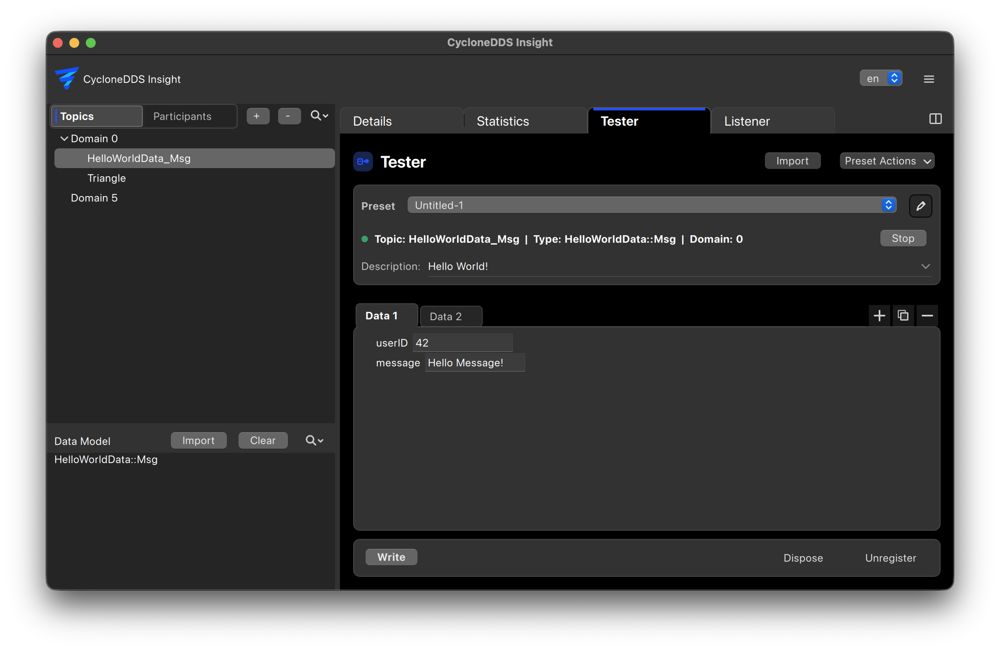

..
   Copyright(c) 2024 Sven Trittler

   This program and the accompanying materials are made available under the
   terms of the Eclipse Public License v. 2.0 which is available at
   http://www.eclipse.org/legal/epl-2.0, or the Eclipse Distribution License
   v. 1.0 which is available at
   http://www.eclipse.org/org/documents/edl-v10.php.

   SPDX-License-Identifier: EPL-2.0 OR BSD-3-Clause

Tester
======

The tester can be used to simulate DDS data flow in the system.

General
-------

1. In the main view select the "Tester" tab
2. From the data model list on the left select the desired topic and create a writer
3. Enter the data to be sent and press "write"

Presets
-------

To quickly test data flow, presets can be used to create multiple writers with predefined data.
Use the "Import" and "Export" buttons to share presets between different |var-project| instances.
Exporting a single sequence also includes every referenced writer with its
configuration and all message data in the same file. Each writer is included once.

Record/Replay exports can also be imported. Import Record/Replay in the main menu
opens Tester and selects the imported sequence without sending any messages.
Normal preset import supports the same format.

Import and export show a loading view immediately while the file is processed.
Wait for completion before editing presets or starting playback. An import only
selects the recorded sequence after it succeeds. For large imports, message
editors are prepared when opened; all messages and sequence steps are retained.

Sequences
---------

Use Edit sequence to add and remove steps. Each step references message data and
has its own Write or Dispose operation and a delay in milliseconds. The delay is
the time since the preceding step. Move steps up or down to change their order;
their operation, delay and selection move with them. The same message can be used
in several steps with different operations. Imported recording delays preserve
the recorded receive-time gaps. New steps and older string-based sequences use
zero delay by default.

Select steps with their checkboxes or use Select all / Deselect all. Choose
Use sequence delays to honor the stored delays, or Fixed interval to use one
interval for every selected step without changing the stored values. The first
selected step is sent immediately. In sequence-delay mode, delays from skipped
steps remain part of the gap between selected steps.

Play prepares any required writers and executes the selected steps. The current
step is highlighted and progress is shown below the editor. Stop cancels later
steps, while any current DDS operation finishes before another playback can
start. Editing is disabled during preparation and playback. Each step also has
a send button that executes it immediately, independently of the selection.
Prepared writers remain active and are reused by subsequent playback.

Enable Repeat before pressing Play to run the selected steps continuously. Repeat
is off by default and does not affect a step's individual send button. Each pass
uses the same writers, operations and timing settings. The fixed interval also
applies between passes. With sequence delays, the first step's delay and any
skipped leading or trailing delays are retained between passes. Progress resets
for each pass. Stop cancels repetition after any current DDS operation finishes.

The individual Write, Dispose and Unregister buttons on a writer still execute
the selected action explicitly.

Sequence JSON
-------------

The complete steps are stored in ``sequence_steps``. The ``sequence_items`` string
list is generated from Write steps only, so older Tester versions execute those
writes and skip Dispose steps. New versions use ``sequence_steps`` whenever that
field exists, even if empty. Older presets containing only ``sequence_items`` are
converted to Write steps with zero delays. Unknown extra step properties are
preserved when editing, duplicating and exporting sequences.

This example writes a message, waits 250 ms and disposes the same instance::

    "sequence_items": ["msg-1"],
    "sequence_steps": [
        {"message_id": "msg-1", "operation": "write", "delay_ms": 0},
        {"message_id": "msg-1", "operation": "dispose", "delay_ms": 250}
    ]
